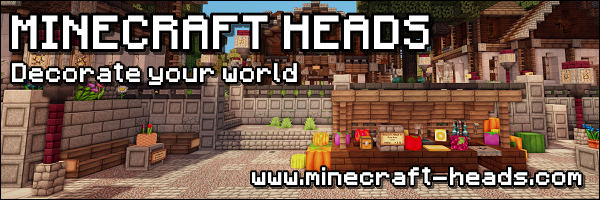

# LibreHeads


[](https://libregalaxy.org/discuss/)

Free and open-source Minecraft decorative & player skull database selector built for [Libre Galaxy Games](https://play.libregalaxy.org). 
Enjoy access to heads from minecraft-heads.com, Marc's Head Format (shout-out to classic Minecraft history), LibreHeads, and your own files!
Easily find what you are looking for through GUI menus for selecting and searching. Notice quality-of-life like "/head search " returning the names of all heads, making it quick to see results.


---

## 📑 Table of Contents

- [Requirements & Installation](#-requirements--installation)
- [Quick Start](#-quick-start)
- [Commands](#-commands)
  - [`/skull`](#skull)
- [Head Databases & Categories](#-head-databases--categories)
- [Data Overrides & Custom Heads](#-data-overrides--custom-heads)
- [Support & Contributing](#-support--contributing)

---

## 🚀 Requirements & Installation

### Requirements
- **Paper 26.3**
- **Java 25+**
- **[VexelCore](https://github.com/ItsMCB/VexelCore)** (plugin dependency)

### Building & Installation
LibreHeads uses decorative head data generously made available by [Minecraft Heads](https://minecraft-heads.com/). To respect data licensing and avoid live API rate-limiting, head snapshots are loaded locally from JSON files.

1. Clone this repository.
2. *(Optional)* Populate `src/main/resources/hdb_frozen/` with your local JSON snapshots of the Minecraft Heads categories (`alphabet.json`, `animals.json`, `blocks.json`, `decoration.json`, `food-drinks.json`, `humans.json`, `humanoid.json`, `miscellaneous.json`, `monsters.json`, `plants.json`). Use the included `download.sh` script to automate the process.
3. Build the plugin JAR with Gradle:
   ```bash
   ./gradlew build
   ```
4. Place both **VexelCore** and `LibreHeads.jar` into your server's `plugins/` directory and start the server.

> [!TIP]
> You do **not** need to rebuild the JAR to add or update head database files! Any JSON file placed under `plugins/LibreHeads/` (such as `plugins/LibreHeads/hdb_frozen/blocks.json`, `plugins/LibreHeads/mhf_frozen/mhf.json`, or `plugins/LibreHeads/miscellaneous.json`) automatically takes priority over the bundled JAR resources.

---

## ⚡ Quick Start

```bash
# Open the main Head Categories GUI
/skull

# Search across all decorative heads, tags, and players
/skull search lantern

# Open the search dialog
/skull search

# Fetch a specific player's head by username (or omit username to open the input dialog)
/skull player Notch
```

---

## 📖 Commands

### `/skull`

**Aliases:** `/head`, `/heads`, `/skulls`  
**Permission:** `libreheads.skull.get`

| Command | Aliases | Description | Permission |
| :--- | :--- | :--- | :--- |
| `/skull [query]` | `/head`, `/heads`, `/skulls` | Opens the main Head Categories GUI, or searches immediately if `[query]` is provided. | `libreheads.skull.get` |
| `/skull menu` | `browse`, `gui` | Opens the main Head Categories GUI. | `libreheads.skull.get` |
| `/skull search [query]` | `find` | Searches decorative heads (by name and tags) and players. Opens an interactive search dialog if `[query]` is omitted. | `libreheads.skull.get` |
| `/skull player [username]` | `user`, `username` | Gives the specified player's head directly, or opens a username input dialog if `[username]` is omitted. | `libreheads.skull.get` |

---

## 🗂️ Head Databases & Categories

### Categories
LibreHeads organizes decorative heads into 10 primary categories plus 2 special collections in the main menu:

| Category | Resource Path | Description |
| :--- | :--- | :--- |
| **Alphabet** | `hdb_frozen/alphabet.json` | Letters, numbers, and special characters. |
| **Animals** | `hdb_frozen/animals.json` | Real and fictional animals and animal characters. |
| **Blocks** | `hdb_frozen/blocks.json` | Miniature blocks. |
| **Decoration** | `hdb_frozen/decoration.json` | Furniture items, props, etc. |
| **Food and Drink** | `hdb_frozen/food-drinks.json` | Food and drinks. |
| **Humans** | `hdb_frozen/humans.json` | Real and fictional human characters. |
| **Humanoid** | `hdb_frozen/humanoid.json` | Human-like characters. |
| **Miscellaneous** | `hdb_frozen/miscellaneous.json` & `miscellaneous.json` | A variety of various things (combines HDB and LibreHeads databases). |
| **Monsters** | `hdb_frozen/monsters.json` | Aliens, ghosts, and other creatures. |
| **Plants** | `hdb_frozen/plants.json` | Shrubbery, fruit, vegetables, etc. |
| **Marc's Head Format** | `mhf_frozen/mhf.json` | Official 2014 Mojang `MHF_*` heads created by Marc Watson for map makers. |
| **Online Players** | *(Live Server State)* | Heads of all players currently online on the server. |

### Database Sources
Each skull displays its origin in its item lore:
- `Head Database`: Frozen snapshots from Minecraft Heads (`hdb_frozen/*.json`)
- `LibreHeads`: Community-curated open skull database (`miscellaneous.json`)
- `Marc's Head Format`: Pre-signed Mojang `MHF_*` textures (`mhf_frozen/mhf.json`)
- `Online Player` / `Player`: Live online players and asynchronously cached Mojang profiles via VexelCore's `CacheManagerV2`

---

## 🛠️ Data Overrides & Custom Heads

### Hot-Swappable Data Folder Overrides
On startup, LibreHeads resolves each database file by checking `plugins/LibreHeads/` first before falling back to the JAR's embedded resources:

```text
plugins/LibreHeads/
├── hdb_frozen/
│   ├── alphabet.json
│   ├── animals.json
│   ├── blocks.json
│   ├── decoration.json
│   ├── food-drinks.json
│   ├── humans.json
│   ├── humanoid.json
│   ├── miscellaneous.json
│   ├── monsters.json
│   └── plants.json
├── mhf_frozen/
│   └── mhf.json
└── miscellaneous.json
```

### JSON Entry Format
Each database file is a JSON array of head objects. Both comma-delimited string tags and JSON array tags are supported:

```json
[
  {
    "name": "Color #123456",
    "uuid": "044af204159e4d9daa47eba925e28cc0",
    "value": "ewogICJ0aW1lc3RhbXAiIDogMTY4MTI0ODkxMjM5Nyw...",
    "signature": "GnRPENIx6fjhNp6EN2MqbbZD4Fldq8yepjY8DJLCPBNN...",
    "tags": ["color", "solid", "blue"]
  }
]
```

- `name` *(required)*: Display name of the skull.
- `value` *(required)*: Base64-encoded Mojang skin texture payload.
- `signature` *(optional)*: Mojang cryptographic texture signature.
- `tags` *(optional)*: Array of strings (`["tag1", "tag2"]`) or comma-separated string (`"tag1, tag2"`) used during `/skull search`.

---

## 🤝 Support & Contributing

### Support
Having trouble or have a question? Get help in the official [Libre Galaxy Discord](https://libregalaxy.org/discuss/).

### Contributing
**New contributors welcome!**
- Extra community heads can be contributed to the [Open Skulls Database](src/main/resources/miscellaneous.json).
- Join us on [Discord](https://libregalaxy.org/discuss/) to meet other maintainers and discuss project contribution.

### License & Credits
- Source code is licensed under the [GNU General Public License v3.0](LICENSE).
- To [support](https://minecraft-heads.com/support-us#banners) the Minecraft Heads project, click their banner below to visit their website:

[](https://minecraft-heads.com/)